  

  

  

  
  

<!--
  Every image above is generated by scripts/render.py (text is baked into vector
  paths, so it renders identically everywhere). Edit the copy in that file, then:
      pip install fonttools && python scripts/render.py
  .github/workflows/refresh-profile.yml re-renders the hero stats once a day.
-->
